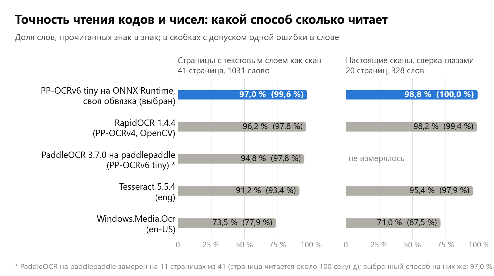
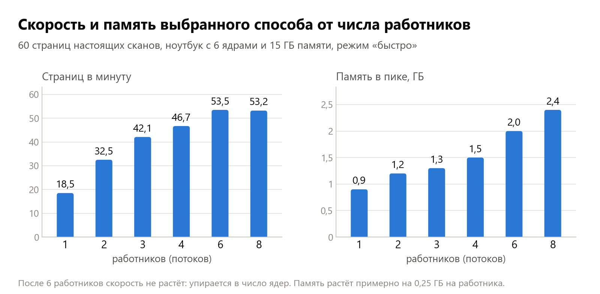
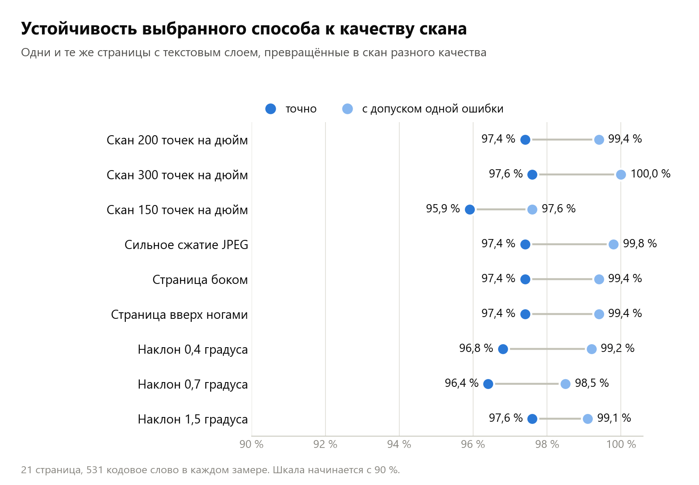
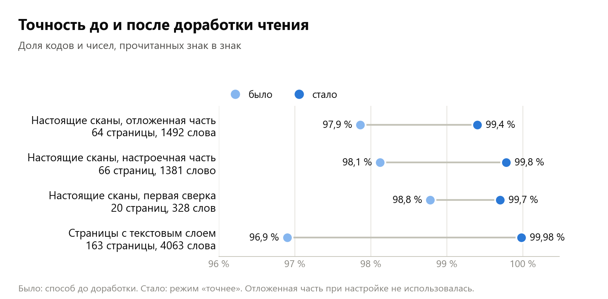
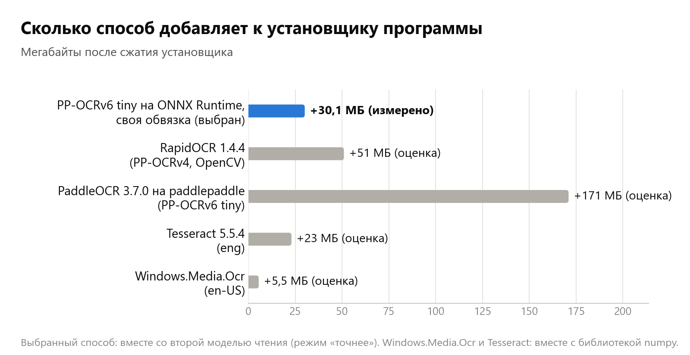
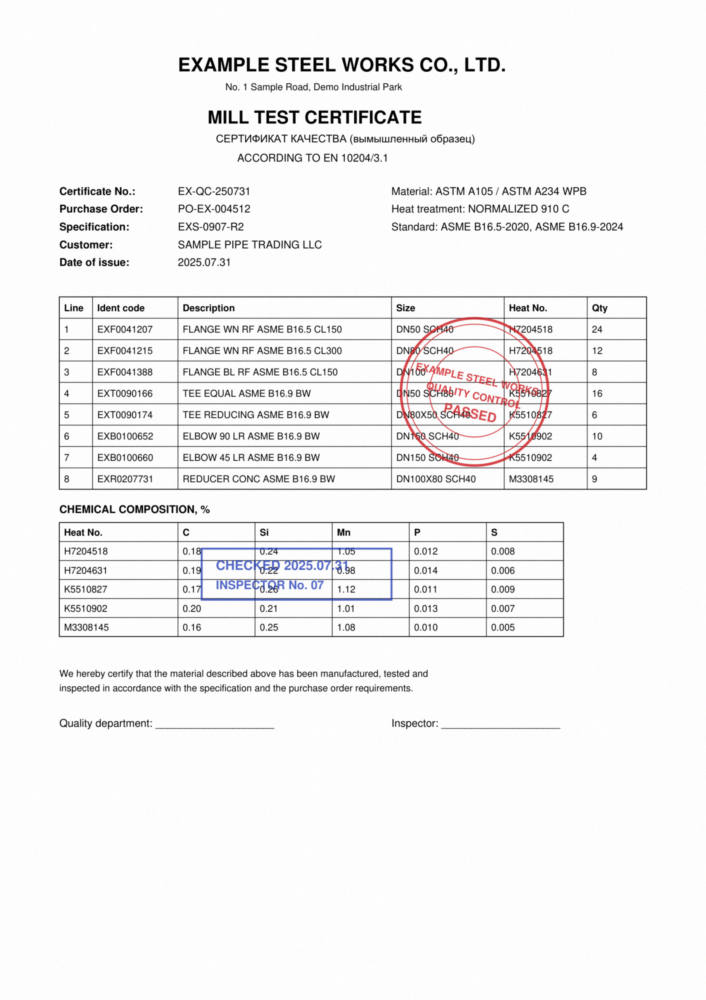
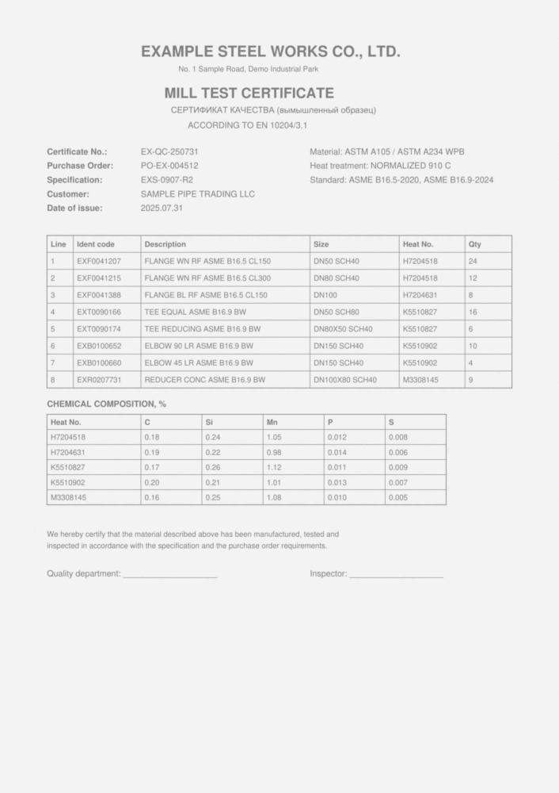

# Распознавание сканов в PackDoc: небольшое исследование

PackDoc читает сканы сертификатов качества: находит в них коды изделий, номера плавок, номера сертификатов и
заказов. Сканы не покидают компьютер: распознавание идёт только на компьютере пользователя, без интернета и без
прав администратора, модели лежат в папке программы.

На этой странице: какие способы распознавания мы сравнили, как мерили, что выбрали и почему, как выбранный способ
ведёт себя на плохих сканах и что было сделано, чтобы поднять точность. Все замеры сделаны на сертификатах качества
двух заводов; самих документов здесь нет, только числа. Примеры на странице нарисованы на выдуманных документах.

## Коротко

- **Вопрос.** Каким способом читать коды и номера со сканов на обычном офисном компьютере: точно, быстро, без
  интернета и без тяжёлого установщика.
- **Что сравнили.** Пять способов: модели PP-OCRv6 на ONNX Runtime со своей обвязкой, RapidOCR, PaddleOCR на
  paddlepaddle, Tesseract и распознавание, встроенное в Windows (раздел 1).
- **Как мерили.** Три набора: страницы с известным текстом, превращённые в скан (4063 кодовых слова), и две ручные
  сверки настоящих сканов (328 и 2873 слова). Часть страниц отложена: на ней ничего не настраивалось (раздел 2).
- **Что выбрали.** Модели PP-OCRv6 tiny на ONNX Runtime: самая высокая точность на кодах, 2-3 секунды на страницу,
  около 30 МБ в установщике (разделы 3-5, 8).
- **Что дало точность.** Снятие цвета печатей, учёт наклона и поворота, вторая модель чтения для сомнительных
  слов-кодов и две правки по смыслу (разделы 6-7).
- **Результат.** На отложенных страницах настоящих сканов знак в знак читается 99,40 % кодовых слов (было
  97,86 %), на страницах с известным текстом 99,98 %. Цель 99,9 % на настоящих сканах не достигнута: мешают
  печати поверх текста (раздел 7).
- **Чего способ не умеет.** Кириллица, рукописный текст, слова под непрозрачной печатью (раздел 9).
- **Исходный код** инструмента распознавания открыт: папка `source` рядом с этой страницей (лицензия AGPL-3.0).

## 1. Что сравнивали

| Способ | Версия и дата выпуска | Откуда | Лицензия |
|---|---|---|---|
| **PP-OCRv6 tiny на ONNX Runtime со своей обвязкой (выбран)** | модели PaddleOCR 3.7.0 (11.06.2026) в формате ONNX из набора RapidOCR 3.10.0 (08.10.2026); ONNX Runtime 1.30.0 (10.09.2026) | [PaddleOCR](https://github.com/PaddlePaddle/PaddleOCR), [RapidOCR](https://github.com/RapidAI/RapidOCR), [ONNX Runtime](https://github.com/microsoft/onnxruntime) | модели Apache-2.0, ONNX Runtime MIT |
| RapidOCR как есть (модели PP-OCRv4, OpenCV) | 1.4.4 (17.01.2025) | [RapidOCR](https://github.com/RapidAI/RapidOCR) | Apache-2.0 |
| PaddleOCR на paddlepaddle («родной») | PaddleOCR 3.7.0 (11.06.2026), paddlepaddle 3.2.2 (14.11.2025) | [PaddleOCR](https://github.com/PaddlePaddle/PaddleOCR) | Apache-2.0 |
| Tesseract | 5.5.4 (28.10.2026) через tesserocr 2.13.0 (12.11.2026), английский язык | [Tesseract](https://github.com/tesseract-ocr/tesseract), [tesserocr](https://github.com/sirfz/tesserocr) | Apache-2.0, tesserocr MIT |
| Windows.Media.Ocr | встроен в Windows 11; пакеты PyWinRT 10.0.28000.2957 (31.10.2026) | часть Windows, [PyWinRT](https://github.com/pywinrt/pywinrt) | часть Windows; PyWinRT MIT |

Способы, которым нужен PyTorch (EasyOCR, docTR, Surya), не замерялись: они добавили бы к установщику от 700 МБ.

«Своя обвязка» значит вот что. Модели PaddleOCR умеют две вещи: найти на странице строки текста и прочитать строку.
Всё остальное (подготовить страницу, определить поворот и наклон, вырезать строки, собрать текст) обычно делает
библиотека вокруг моделей. Мы написали эту часть сами на numpy: она не тянет за собой OpenCV, поэтому заметно
легче, а по замерам ещё и точнее и быстрее готовой.

## 2. Как мерили

Нас интересуют не слова вообще, а **кодовые слова**: слова из латинских букв и цифр длиной от 6 знаков, в которых
есть хотя бы одна цифра (коды изделий, номера плавок, номера сертификатов, размеры, даты). Именно они нужны
программе, и именно в них одна ошибка в знаке делает слово бесполезным.

- **Точно**: слово сверки есть в прочитанном тексте страницы знак в знак, столько раз, сколько оно встречается
  на странице. Слово сверки это код или число без соседних знаков препинания: если код стоит внутри более
  длинной записи (например, в шифре документа), проверяется, что прочитан он сам.
- **С допуском одной ошибки**: в слове не больше одного неверного, лишнего или пропущенного знака. Такие слова
  программа всё равно находит, когда знает, что искать (например, код изделия из заказа).

Три набора для проверки:

| Набор | Что это | Сколько |
|---|---|---|
| Страницы с текстовым слоем | PDF, в которых текст уже есть. Страница превращается в картинку «как скан» (200 точек на дюйм, размытие, шум, сжатие JPEG), распознаётся, результат сверяется с текстом из файла. Истина точная и ничего не стоит | 41 страница, 1031 кодовое слово (вся выборка: 163 страницы, 4063 слова) |
| Настоящие сканы, первая сверка | Страницы настоящих сканов двух заводов: боком, с печатями, бледные. Слова выписаны глазами | 20 страниц, 328 слов |
| Настоящие сканы, большая сверка | Каждую страницу читают три независимых способа; слово принято без просмотра, только если два разных семейства моделей прочли его одинаково, остальное сверено глазами по вырезкам | 130 страниц, 2873 слов (см. раздел 7) |

## 3. Итоги сравнения

| Способ | Страницы с текстовым слоем: точно / с одной ошибкой | Настоящие сканы (328 слов): точно / с одной ошибкой |
|---|---|---|
| **PP-OCRv6 tiny на ONNX Runtime, своя обвязка** | **97,0 % / 99,6 %** | **98,8 % / 100 %** |
| RapidOCR 1.4.4 (PP-OCRv4, OpenCV) | 96,2 % / 97,8 % | 98,2 % / 99,4 % |
| PaddleOCR 3.7.0 на paddlepaddle (PP-OCRv6 tiny) | 94,8 % / 97,8 % (на 11 страницах) | не измерялось |
| Tesseract 5.5.4 (eng) | 91,2 % / 93,4 % | 95,4 % / 97,9 % |
| Windows.Media.Ocr (en-US) | 73,5 % / 77,9 % | 71,0 % / 87,5 % |

Это числа первого сравнения, по ним выбирался способ. После доработки (раздел 7) выбранный способ читает точнее.

Что ещё проверили:

- **PaddleOCR на paddlepaddle** на тех же моделях читает примерно так же, но на обычном процессоре без видеокарты
  тратит около 100 секунд на страницу против 5-10 у выбранного способа и добавил бы к установщику около 171 МБ.
- **Более крупные модели** (PP-OCRv6 medium, PP-OCRv5 server) на кодах точнее не оказались (95,2 % и 90,5 % против
  96,6 % у tiny на тех же страницах), а работают в 20-25 раз дольше.

## 4. Что выбрано и почему

Модели PP-OCRv6 tiny на ONNX Runtime со своей обвязкой:

- самая высокая точность на кодах из всех замеренных способов;
- работает на любом компьютере с Windows: не зависит от языков, установленных в системе, и от видеокарты;
- добавляет к установщику около 30 МБ вместе со второй моделью чтения (раздел 8);
- читает страницу за 2-3 секунды в один поток и умеет работать в несколько потоков.

Остальные способы остались доступны по имени; Windows.Media.Ocr служит запасным, если основной не запустился.

## 5. Скорость и память

Замер на 60 страницах настоящих сканов, ноутбук с 6 ядрами и 15 ГБ памяти, режим «быстро». Работник это один поток
распознавания со своим экземпляром моделей. Программа сама выбирает число работников: по одному на ядро, но не
больше шести и не больше, чем помещается в свободную память; если памяти мало, работает в один поток.
Повторное открытие того же файла занимает секунды: прочитанные страницы хранятся в кэше на диске.

## 6. Устойчивость к качеству скана

Одни и те же страницы превращались в сканы разного качества (режим «быстро», до доработки из раздела 7):

- **Разрешение.** 200 и 300 точек на дюйм читаются одинаково хорошо; при 150 точность падает на полтора процента.
- **Сжатие.** Сильное сжатие JPEG на точность не влияет.
- **Поворот.** Страница боком или вверх ногами определяется сама (верно на всех проверенных страницах) и читается
  так же, как прямая.
- **Наклон.** У настоящих сканов наклон есть почти всегда (в среднем четверть градуса). Он измеряется по длинным
  строкам и учитывается: до 0,6 градуса строки вырезаются вдоль наклона, дальше страница выравнивается.
- **Цветные печати поверх текста.** Перед чтением цвет убирается: красные и синие печати становятся светлыми, чёрный
  текст остаётся. Это подняло точность на настоящих сканах с 97,9 % до 98,8 %.

Что дал каждый приём (точное чтение кодовых слов):

| Приём | Без него | С ним |
|---|---|---|
| Снятие цвета печатей | 97,9 % | 98,8 % |
| Учёт небольшого наклона (0,4 градуса) | 92,3 % | 96,8 % |
| Выравнивание заметного наклона (1,5 градуса) | 94,7 % | 97,6 % |
| Повторный поиск строк на странице, лежавшей боком | 95,1 % | 97,4 % |
| Поиск строк в полном размере страницы вместо уменьшенного | 94,4 % | 97,4 % |
| Поиск известного кода изделия с допуском похожих знаков (0 и O, 1 и I) | 97,8 % кодов изделий | 100 % кодов изделий |

## 7. Работа над точностью

После первого сравнения выбранный способ читал знак в знак около 98 % кодовых слов на настоящих сканах. Задача
второй части: поднять это число как можно ближе к 100 % и честно измерить, что получилось.

### Мерило крупнее

328 слов мало: одно слово это 0,3 %. Поэтому собрана большая сверка по настоящим сканам: 130 страниц двух заводов
(страницы боком, с печатями, с наклоном, бледные), 2873 кодовых слова.

- Каждую страницу прочитали три способа: выбранный (PP-OCRv6 tiny), модель PP-OCRv4 на тех же строках и Tesseract
  со своим поиском слов.
- Слово принималось без просмотра, только если выбранный способ и Tesseract (другое семейство моделей) прочли его
  одинаково в одном и том же месте страницы: так принято 2622 слова.
- Остальные 395 мест (расхождение или слово только у одного способа) просмотрены глазами по вырезкам:
  из них в сверку вошло 251 слово.
- Русские слова, которые модели читают латиницей («РАЗМЕР» как «PA3MEP»), рукописные даты и слова, которые под
  печатью не читаются и глазами, в сверку не входят.
- Страницы разделены по файлам на две части: **настроечную** (66 страниц, 1381 слово), на ней подбирались
  приёмы, и **отложенную** (64 страницы, 1492 слова), на неё до итогового замера не смотрели.

Слова считаются строго: если слово встречается на странице три раза, оно должно быть прочитано три раза.

### Какие промахи были

Разбор промахов выбранного способа до доработки (примеры выдуманные, вид ошибки настоящий):

| Вид промаха | Настроечная часть сканов | Страницы с текстовым слоем | Пример |
|---|---|---|---|
| Цифра сразу после буквы прочитана буквой (0 как O, 1 как I) | 11 | 3 | `K07-12-340` прочитано как `KO7-12-340` |
| Римская цифра VIII, набранная одним знаком | 2 | 26 | `ASME Ⅷ UW-51` как `ASME VII UW-51` |
| Печать или помарка поверх слова | 5 | 0 | `2025.7.31` как `20257.31` |
| Потерян знак в ряду одинаковых или знак препинания | 3 | 0 | `EXF0003318` как `EXF003318` |
| Буква O и цифра 0 внутри слова | 3 | 0 | `EXF0002754` как `EXFO002754` |
| Буква в жирном шрифте (F как P) | 2 | 0 | `A350 LF2` как `A350 LP2` |
| Знаки, неразличимые по картинке (I и 1) | 0 | 2 | |
| **Всего** | **26 из 1381** | **31 из 1031** | |

Строк с кодами, которые поиск строк не нашёл вовсе, не обнаружено.

### Что сделано

1. **Вторая модель читает слова-коды ещё раз.** Модель PP-OCRv4 ошибается в других местах, чем PP-OCRv6 tiny:
   там, где первая читает `KO7`, вторая читает `K07`. Но целиком заменить первую она не может: она не ставит
   пробелы между латинскими словами и работает в несколько раз медленнее. Поэтому она перечитывает только слова
   с цифрами, в которых первая модель не вполне уверена, и только вырезку слова, а не всю строку.
2. **Два чтения сливаются по знакам.** Пробелы берутся у первой модели; там, где чтения расходятся, берётся знак
   второй модели, если первая не уверена в своём знаке заметно сильнее; знак, который прочла только вторая
   модель, добавляется; крайние знаки слова не теряются.
3. **Две правки по смыслу.** Римская цифра перед пунктом `UW-NN` всегда VIII (пункты UW есть только в разделе VIII
   кодекса ASME), а марки стали по ASTM A350 называются LF, а не LP. Оба правила заменяют только то, чего в
   документах не бывает.

Что пробовали и не взяли: выбор знака просто по уверенности моделей (первая модель уверена и в своих ошибках),
перечитывание той же моделью вырезки другого размера, контраста или без снятия цвета (ошибки повторяются),
правило «буква O между цифрами это ноль» (ничего не добавило).

### Что получилось

Доля кодовых слов, прочитанных знак в знак:

| Набор | Слов | Было | Стало: режим «быстро» | Стало: режим «точнее» |
|---|---|---|---|---|
| Настоящие сканы, настроечная часть | 1381 | 98,12 % | 98,41 % | **99,78 %** |
| Настоящие сканы, **отложенная часть** | 1492 | 97,86 % | 97,99 % | **99,40 %** |
| Настоящие сканы, первая сверка | 328 | 98,78 % | 98,78 % | **99,70 %** |
| Страницы с текстовым слоем (выборка для настройки) | 1031 | 96,99 % | 99,52 % | **99,90 %** |
| Страницы с текстовым слоем (все 163) | 4063 | 96,9 % | 99,61 % | **99,98 %** |

С допуском одной ошибки в слове на отложенной части было 99,87 %, стало 99,93 %. Коды изделий (буквы и 5-7 цифр)
на отложенной части: было 80 из 92 знак в знак, стало 92 из 92. По заводам на отложенной части: первый завод
100 % (895 слов), второй 98,49 % (597 слов: у него плотные таблицы и печати поверх текста).

Главное число здесь отложенная часть: **99,40 %**, это 9 непрочитанных слов из 1492. Цели 99,9 % на ней достичь не
удалось. Что осталось непрочитанным:

| Причина | Слов |
|---|---|
| Печать поверх слова (потеряна точка, искажён знак) | 4 |
| Вторая модель ошиблась там, где первая прочла верно, и её знак был принят | 2 |
| Мелкий жирный плотный текст | 1 |
| Помарка вплотную к слову | 1 |
| Шрифт, в котором O и 0 одинаковы | 1 |

Оговорка о самой сверке. После итогового замера 15 расхождений на отложенной части были просмотрены глазами. В 6
случаях ошибалась не программа, а сверка: слово было принято без просмотра, потому что выбранный способ и
Tesseract одинаково ошиблись (ноль прочитан как O), а новый режим прочёл верно. Эти 6 слов в сверке исправлены;
без исправления отложенная часть давала 99,00 % против 98,19 % до доработки.

### Сколько это стоит

Режим «точнее» включён по умолчанию. Режим «быстро» (одна модель чтения и правки по смыслу) остался:
он включается параметром `quality='fast'`.

| | Режим «быстро» | Режим «точнее» |
|---|---|---|
| Отложенная часть сканов, точно | 97,99 % | 99,40 % |
| Страницы с текстовым слоем (163), точно | 99,61 % | 99,98 % |
| Страниц в минуту, один поток | 26,8 | 19,5 |
| Страниц в минуту, четыре потока | 49,0 | 42,2 |
| Память в пике, один поток и четыре | 0,7 и 1,5 ГБ | 0,8 и 1,4 ГБ |

Замер на 30 страницах настоящих сканов на том же ноутбуке. Время выросло на 37 % в один поток и на 16 % в четыре
потока. Вторая модель весит 10,9 МБ. Выборка страниц здесь другая, чем на графике в разделе 5, поэтому числа
режима «быстро» с ним напрямую не сравниваются.

## 8. Вес в установщике

С распознаванием установщик программы вырос на 30,1 МБ (измерено сборкой): библиотека ONNX Runtime,
NumPy и четыре файла моделей (17,8 МБ: поиск строк 1,8, чтение 4,5, вторая модель чтения 10,9, перевёрнутая строка
0,6). Остальные способы оценены сжатием тех же файлов, что вошли бы в установщик.

## 9. Ограничения

- **Кириллица не читается.** Выбранные модели знают латиницу, цифры и китайский. Русские слова в двуязычных
  бланках превращаются в похожие латинские буквы. Кодам и числам это не мешает: они записаны латиницей и цифрами.
- **Рукописный текст не читается надёжно:** подписи, пометки от руки, даты, вписанные ручкой.
- **Текст, закрытый непрозрачной печатью или помаркой,** прочитать нельзя ни одним способом.
- **Стопроцентной точности на любых будущих документах обещать нельзя.** Поэтому программа не полагается на одно
  чтение: известные коды ищутся с допуском похожих знаков, а всё, что найдено неуверенно или не найдено, попадает
  в список мест для проверки человеком.

## 10. Примеры

Страницы ниже выдуманы и нарисованы скриптом `source/tools/ocr_examples.py`: названия, номера и коды придуманы. Полный
набор с прочитанным текстом лежит в [examples/README.md](examples/README.md).

| Цветные печати поверх текста | Бледный скан с сильным сжатием |
|---|---|
|  |  |

Что видно на примерах: все 16 известных кодов найдены на каждой странице, в том числе под печатями, на
странице боком (поворот определён сам), с наклоном 1,5 градуса и на бледном скане с сильным сжатием. Русская
строка заголовка читается неверно: кириллицу модели не знают.

## 11. Лицензии

Вместе с программой распространяются:

| Что | Лицензия | Проект |
|---|---|---|
| Модели PP-OCRv6 tiny (поиск и чтение строк), PP-OCRv4 (вторая модель чтения), PP-OCR mobile v2.0 (перевёрнутая строка) | Apache-2.0 | [PaddleOCR](https://github.com/PaddlePaddle/PaddleOCR); файлы в формате ONNX из [RapidOCR](https://github.com/RapidAI/RapidOCR) (Apache-2.0) |
| ONNX Runtime (исполнение моделей) | MIT | [microsoft/onnxruntime](https://github.com/microsoft/onnxruntime) |
| NumPy | BSD-3-Clause | [numpy/numpy](https://github.com/numpy/numpy) |
| PyWinRT (доступ к Windows.Media.Ocr) | MIT | [pywinrt/pywinrt](https://github.com/pywinrt/pywinrt) |

Происхождение моделей и текст лицензии Apache-2.0 лежат рядом с моделями в папке программы
(`source/ocrkit/models/NOTICE.md`), лицензии библиотек в папке `licenses`.

## 12. Как повторить

- Графики: `python source/tools/ocr_charts.py` (числа в `measurements.json`).
- Примеры: `python source/tools/ocr_examples.py`.
- Замеры на своих документах: `python source/tools/ocr_bench.py truth <папка с PDF>` (точность на страницах с текстовым
  слоем) и `python source/tools/ocr_bench.py speed <папка со сканами>` (скорость и память).
- Проверка пакета: `python source/tests/test_ocrkit.py`.
