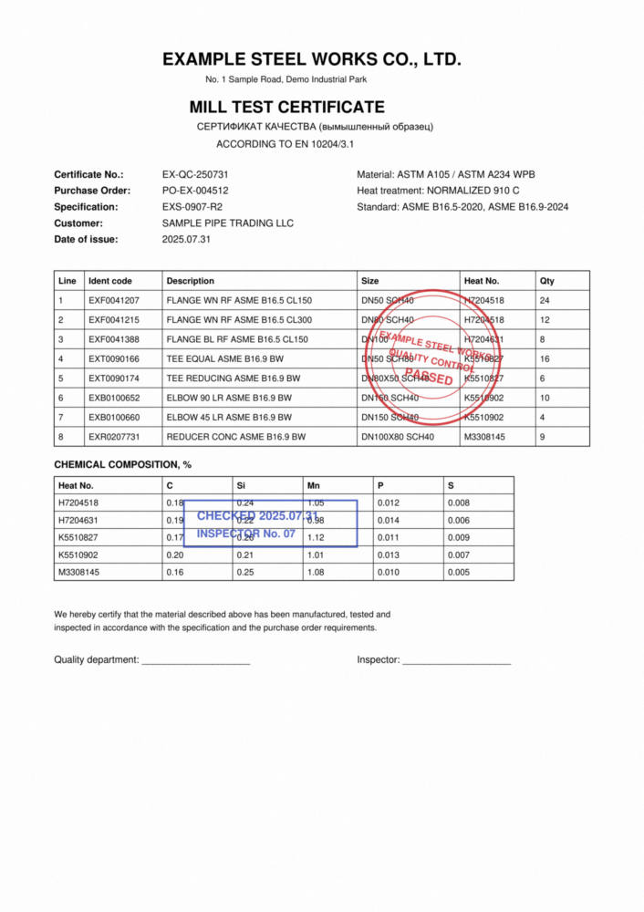
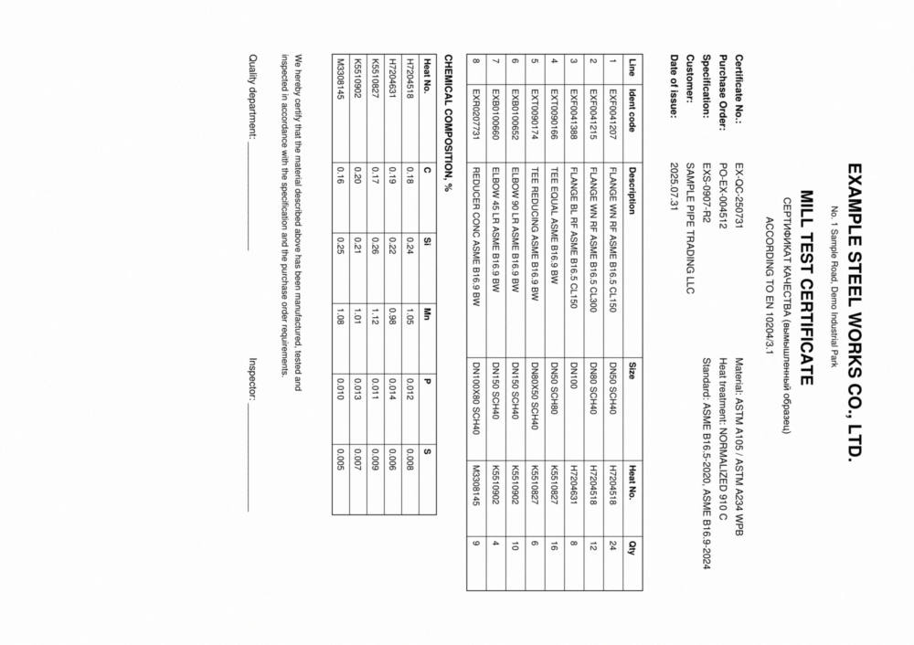
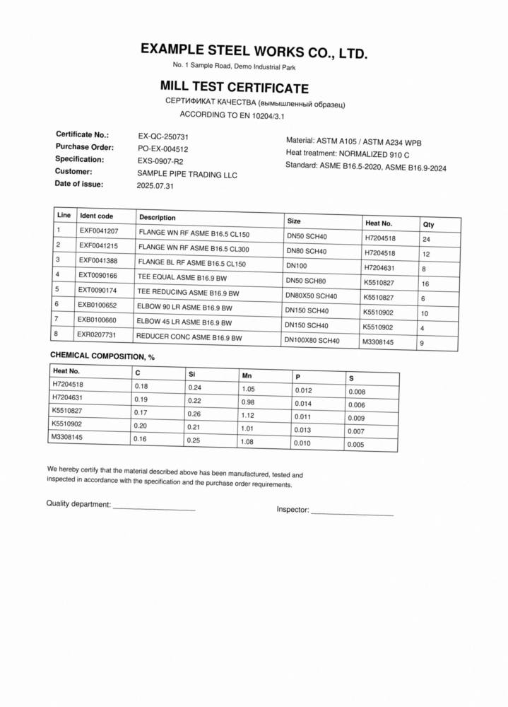
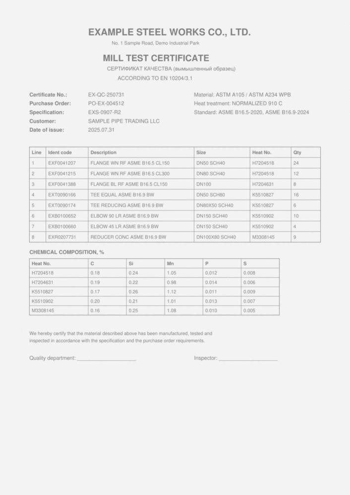
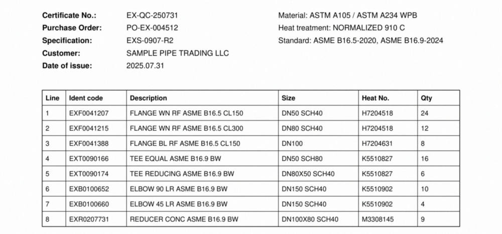

# Примеры распознавания

Все страницы ниже выдуманы: названия, номера и коды придуманы для примера и нарисованы скриптом
`source/tools/ocr_examples.py`. Картинки уменьшены, распознавалась страница в 200 точек на дюйм.
Время указано для ноутбука разработки (один поток), вместе с рендером страницы.

Известные коды, которые ищутся на странице: 16 (коды изделий, номера плавок, номер сертификата, заказа и спецификации).

## Чистый скан


- время: 1.9 с; строк найдено: 113; поворот: 0 градусов; наклон: 0.02 градуса
- известных кодов на странице 16: прочитано знак в знак 16, найдено с поправкой похожих знаков 0, не найдено 0

Прочитанный текст (полностью в файле `01_clean.txt`, табуляция разделяет куски одной зрительной строки):

```text
EXAMPLE STEEL WORKS CO., LTD.
No. 1 Sample Road, Demo Industrial Park
MILL TEST CERTIFICATE
CEPTIΦVKAT KAYECTBA (BbIMbI山NeHHbIÑ o6pa3eu)
ACCORDING TO EN 10204/3.1
Certificate No.:	EX-QC-250731	Material: ASTM A105 / ASTM A234 WPB
Purchase Order:	PO-EX-004512	Heat treatment: NORMALIZED 910 C
Specification:	EXS-0907-R2	Standard: ASME B16.5-2020, ASME B16.9-2024
Customer:	SAMPLE PIPE TRADING LLC
Date of issue:	2025.07.31
Line	Ident code	Description	Size	Heat No.	Qty
1	EXF0041207	FLANGE WN RF ASME B16.5 CL150	DN50 SCH40	H7204518	24
2	EXF0041215	FLANGE WN RF ASME B16.5 CL300	DN80 SCH40	H7204518	12
3	EXF0041388	FLANGE BL RF ASME B16.5 CL150	DN100	H7204631	8
4	EXT0090166	TEE EQUAL ASME B16.9 BW	DN50 SCH80	K5510827	16
5	EXT0090174	TEE REDUCING ASME B16.9 BW	DN80X50 SCH40	K5510827	6
6	EXB0100652	ELBOW 90 LR ASME B16.9 BW	DN150 SCH40	K5510902	10
7	EXB0100660	ELBOW 45 LR ASME B16.9 BW	DN150 SCH40	K5510902	4
8	EXR0207731	REDUCER CONC ASME B16.9 BW	DN100X80 SCH40	M3308145	9
CHEMICAL COMPOSITION, %
Heat No.	C	Si	Mn	P	S
H7204518	0.18	0.24	1.05	0.012	0.008
H7204631	0.19	0.22	0.98	0.014	0.006
K5510827	0.17	0.26	1.12	0.011	0.009
K5510902	0.20	0.21	1.01	0.013	0.007
M3308145	0.16	0.25	1.08	0.010	0.005
We hereby certify that the material described above has been manufactured, tested and
inspected in accordance with the specification and the purchase order requirements.
...
```

## Цветные печати поверх текста



- время: 2.03 с; строк найдено: 117; поворот: 0 градусов; наклон: 0.03 градуса
- известных кодов на странице 16: прочитано знак в знак 16, найдено с поправкой похожих знаков 0, не найдено 0

Прочитанный текст (полностью в файле `02_stamp.txt`, табуляция разделяет куски одной зрительной строки):

```text
EXAMPLE STEEL WORKS CO., LTD.
No. 1 Sample Road, Demo Industrial Park
MILL TEST CERTIFICATE
CEPTIΦVKAT KAYECTBA (BbIMbI山NeHHbIÑ o6pa3eu)
ACCORDING TO EN 10204/3.1
Certificate No.:	EX-QC-250731	Material: ASTM A105 / ASTM A234 WPB
Purchase Order:	PO-EX-004512	Heat treatment: NORMALIZED 910 C
Specification:	EXS-0907-R2	Standard: ASME B16.5-2020, ASME B16.9-2024
Customer:	SAMPLE PIPE TRADING LLC
Date of issue:	2025.07.31
Line	Ident code	Description	Size	Heat No.	Qty
1	EXF0041207	FLANGE WN RF ASME B16.5 CL150	DN50 SCH40	H7204518	24
2	EXF0041215	FLANGE WN RF ASME B16.5 CL300	DN80 SCH40	H7204518	12
3	EXF0041388	FLANGE BL RF ASME B16.5 CL150	DN0 MPLE STE	H7204631	8
4	EXT0090166	TEE EQUAL ASME B16.9 BW	CN5o0 SCH0/TY CON	K5510827	16
S
5	EXT0090174	TEE REDUCING ASME B16.9 BW	DN80X50 SCA40SED	K5510827	6
6	EXB0100652	ELBOW 90 LR ASME B16.9 BW	DN150 SCH40	K5510902	10
7	EXB0100660	ELBOW 45 LR ASME B16.9 BW	DN150 SCH40	K5510902	4
8	EXR0207731	REDUCER CONC ASME B16.9 BW	DN100X80 SCH40	M3308145	9
CHEMICAL COMPOSITION, %
Heat No.	C	Si	Mn	P	S
H7204518	0.18	0.24	1.05	0.012	0.008
H7204631	0.19	CHEC	0.22	2025.07	0.98	0.014	0.006
K5510827	0.17	INSPE	0.26RNo.07	1.12	0.011	0.009
K5510902	0.20	0.21	1.01	0.013	0.007
M3308145	0.16	0.25	1.08	0.010	0.005
We hereby certify that the material described above has been manufactured, tested and
...
```

## Страница лежит боком



- время: 2.89 с; строк найдено: 113; поворот: 270 градусов; наклон: 0.01 градуса
- известных кодов на странице 16: прочитано знак в знак 16, найдено с поправкой похожих знаков 0, не найдено 0

Прочитанный текст (полностью в файле `03_sideways.txt`, табуляция разделяет куски одной зрительной строки):

```text
EXAMPLE STEEL WORKS CO., LTD.
No. 1 Sample Road, Demo Industrial Park
MILL TEST CERTIFICATE
CEPTIΦVKAT KAYECTBA (BbIMbNeHHbIÑ 06pa3eu)
ACCORDING TO EN 10204/3.1
Certificate No.:	EX-QC-250731	Material: ASTM A105 / ASTM A234 WPB
Purchase Order:	PO-EX-004512	Heat treatment: NORMALIZED 910 C
Specification:	EXS-0907-R2	Standard: ASME B16.5-2020, ASME B16.9-2024
Customer:	SAMPLE PIPE TRADING LLC
Date of issue:	2025.07.31
Line	Ident code	Description	Size	Heat No.	Qty
1	EXF0041207	FLANGE WN RF ASME B16.5 CL150	DN50 SCH40	H7204518	24
2	EXF0041215	FLANGE WN RF ASME B16.5 CL300	DN80 SCH40	H7204518	12
3	EXF0041388	FLANGE BL RF ASME B16.5 CL150	DN100	H7204631	8
4	EXT0090166	TEE EQUAL ASME B16.9 BW	DN50 SCH80	K5510827	16
5	EXT0090174	TEE REDUCING ASME B16.9 BW	DN80X50 SCH40	K5510827	6
6	EXB0100652	ELBOW 90 LR ASME B16.9 BW	DN150 SCH40	K5510902	10
7	EXB0100660	ELBOW 45 LR ASME B16.9 BW	DN150 SCH40	K5510902	4
8	EXR0207731	REDUCER CONC ASME B16.9 BW	DN100X80 SCH40	M3308145	9
CHEMICAL COMPOSITION, %
Heat No.	C	Si	Mn	P	S
H7204518	0.18	0.24	1.05	0.012	0.008
H7204631	0.19	0.22	0.98	0.014	0.006
K5510827	0.17	0.26	1.12	0.011	0.009
K5510902	0.20	0.21	1.01	0.013	0.007
M3308145	0.16	0.25	1.08	0.010	0.005
We hereby certify that the material described above has been manufactured, tested and
inspected in accordance with the specification and the purchase order requirements.
...
```

## Наклон 1.5 градуса



- время: 3.34 с; строк найдено: 113; поворот: 0 градусов; наклон: 1.5 градуса
- известных кодов на странице 16: прочитано знак в знак 16, найдено с поправкой похожих знаков 0, не найдено 0

Прочитанный текст (полностью в файле `04_skew.txt`, табуляция разделяет куски одной зрительной строки):

```text
EXAMPLE STEEL WORKS CO., LTD.
No. 1 Sample Road, Demo Industrial Park
MILL TEST CERTIFICATE
CEPTIΦVKAT KAYECTBA (BbIMbIWNeHHbIÑ 06pa3eu)
ACCORDING TO EN 10204/3.1
Certificate No.:	EX-QC-250731	Material: ASTM A105 / ASTM A234 WPB
Purchase Order:	PO-EX-004512	Heat treatment: NORMALIZED 910 C
Specification:	EXS-0907-R2	Standard: ASME B16.5-2020, ASME B16.9-2024
Customer:	SAMPLE PIPE TRADING LLC
Date of issue:	2025.07.31
Line	Ident code	Description	Size	Heat No.	Qty
1	EXF0041207	FLANGE WN RF ASME B16.5 CL150	DN50 SCH40	H7204518	24
2	EXF0041215	FLANGE WN RF ASME B16.5 CL300	DN80 SCH40	H7204518	12
3	EXF0041388	FLANGE BL RF ASME B16.5 CL150	DN100	H7204631	8
4	EXT0090166	TEE EQUAL ASME B16.9 BW	DN50 SCH80	K5510827	16
5	EXT0090174	TEE REDUCING ASME B16.9 BW	DN80X50 SCH40	K5510827	6
6	EXB0100652	ELBOW 90 LR ASME B16.9 BW	DN150 SCH40	K5510902	10
7	EXB0100660	ELBOW 45 LR ASME B16.9 BW	DN150 SCH40	K5510902	4
8	EXR0207731	REDUCER CONC ASME B16.9 BW	DN100X80 SCH40	M3308145	9
CHEMICAL COMPOSITION, %
Heat No.	C	Si	Mn	P	S
H7204518	0.18	0.24	1.05	0.012	0.008
H7204631	0.19	0.22	0.98	0.014	0.006
K5510827	0.17	0.26	1.12	0.011	0.009
K5510902	0.20	0.21	1.01	0.013	0.007
M3308145	0.16	0.25	1.08	0.010	0.005
We hereby certify that the material described above has been manufactured, tested and
inspected in accordance with the specification and the purchase order requirements.
...
```

## Бледный скан с сильным сжатием



- время: 1.96 с; строк найдено: 113; поворот: 0 градусов; наклон: 0.01 градуса
- известных кодов на странице 16: прочитано знак в знак 16, найдено с поправкой похожих знаков 0, не найдено 0

Прочитанный текст (полностью в файле `05_pale_jpeg.txt`, табуляция разделяет куски одной зрительной строки):

```text
EXAMPLE STEEL WORKS CO., LTD.
No.1 Sample Road, Demo Industrial Park
MILL TEST CERTIFICATE
CEPTIΦVKAT KA4ECTBA (BbIMbINeHHbIé o6pa3eu)
ACCORDING TO EN 10204/3.1
Certificate No.:	EX-QC-250731	Material: ASTM A105 / ASTM A234 WPB
Purchase Order:	PO-EX-004512	Heat treatment: NORMALIZED 910 C
Specification:	EXS-0907-R2	Standard: ASMEB16.5-2020,ASME B16.9-2024
Customer:	SAMPLE PIPE TRADING LLC
Date of issue:	2025.07.31
Line	Ident code	Description	Size	Heat No.	Qty
1	EXF0041207	FLANGE WN RF ASME B16.5 CL150	DN50 SCH40	H7204518	24
2	EXF0041215	FLANGE WN RF ASME B16.5 CL300	DN80 SCH40	H7204518	12
3	EXF0041388	FLANGE BL RF ASME B16.5 CL150	DN100	H7204631	8
4	EXT0090166	TEE EQUAL ASME B16.9 BW	DN50 SCH80	K5510827	16
5	EXT0090174	TEE REDUCING ASME B16.9 BW	DN80X50 SCH40	K5510827	6
6	EXB0100652	ELBOW 90 LR ASME B16.9BW	DN150 SCH40	K5510902	10
7	EXB0100660	ELBOW45 LR ASME B16.9 BW	DN150 SCH40	K5510902	4
8	EXR0207731	REDUCER CONC ASME B16.9 BW	DN100X80 SCH40	M3308145	9
CHEMICAL COMPOSITION, %
Heat No.	C	Si	Mn	P	S
H7204518	0.18	0.24	1.05	0.012	0.008
H7204631	0.19	0.22	0.98	0.014	0.006
K5510827	0.17	0.26	1.12	0.011	0.009
K5510902	0.20	0.21	1.01	0.013	0.007
M3308145	0.16	0.25	1.08	0.010	0.005
We hereby certify that the material described above has been manufactured, tested and
inspected in accordance with the specification and the purchase order requirements.
...
```

## Только полоса бланка (часть страницы)



- время: 1.09 с; строк найдено: 67; поворот: 0 градусов; наклон: 0.0 градуса
- известных кодов на странице 13: прочитано знак в знак 13, найдено с поправкой похожих знаков 0, не найдено 0

Прочитанный текст (полностью в файле `06_band.txt`, табуляция разделяет куски одной зрительной строки):

```text
Certificate No.:	EX-QC-250731	Material: ASTM A105 / ASTM A234 WPB
Purchase Order:	PO-EX-004512	Heat treatment: NORMALIZED 910 C
Specification:	EXS-0907-R2	Standard: ASME B16.5-2020, ASME B16.9-2024
Customer:	SAMPLE PIPE TRADING LLC
Date of issue:	2025.07.31
Line	Ident code	Description	Size	Heat No.	Qty
1	EXF0041207	FLANGE WN RF ASME B16.5 CL150	DN50 SCH40	H7204518	24
2	EXF0041215	FLANGE WN RF ASME B16.5 CL300	DN80 SCH40	H7204518	12
3	EXF0041388	FLANGE BL RF ASME B16.5 CL150	DN100	H7204631	8
4	EXT0090166	TEE EQUAL ASME B16.9 BW	DN50 SCH80	K5510827	16
5	EXT0090174	TEE REDUCING ASME B16.9 BW	DN80X50 SCH40	K5510827	6
6	EXB0100652	ELBOW 90 LR ASME B16.9 BW	DN150 SCH40	K5510902	10
7	EXB0100660	ELBOW 45 LR ASME B16.9 BW	DN150 SCH40	K5510902	4
8	EXR0207731	REDUCER CONC ASME B16.9 BW	DN100X80 SCH40	M3308145	9
```
